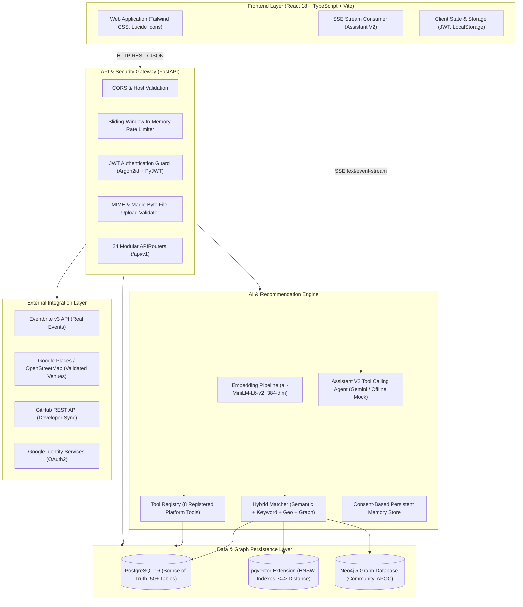
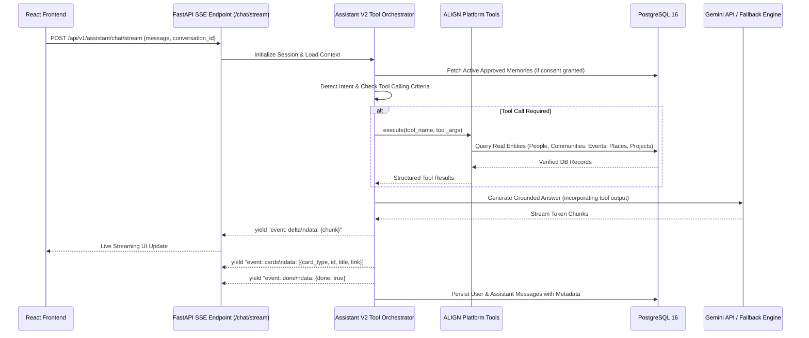

# ALIGN System Architecture & Engineering Specifications

**Platform**: ALIGN — AI-Powered Social Discovery & Collaboration Platform  
**Version**: 2.0.0 (Production Release)  
**Date**: November 13, 2026  
**Status**: Demonstrable Final-Year Engineering Project  

---

## 1. High-Level System Architecture

ALIGN is architected as an intent-first, vector-semantic, and graph-connected social discovery and collaboration platform. It unifies relational persistence (PostgreSQL 16), dense vector similarity search (`pgvector`), knowledge graph traversal (Neo4j 5), real-time generative intelligence (Assistant V2 Tool-Calling Agent), and a responsive React 18 single-page application.

---

## 2. Component Subsystems

### 2.1 Frontend Client (`frontend/`)
- **Technology Stack**: React 18.3, TypeScript 5.6, Vite 5.4, Tailwind CSS 3.4.
- **Central HTTP Layer**: [`frontend/src/lib/api.ts`](file:///d:/Align%20final/Align/frontend/src/lib/api.ts) with strict TypeScript interfaces, unified error handling, automatic `Bearer` JWT attachment, and token refresh interceptors.
- **Key Modules & Pages**:
  - `Landing.tsx`: Hero search input, value proposition, and instant prompt starters.
  - `Discover.tsx`: Real-time intent search with vector similarity indicators, source verification badges, and category filters.
  - `Communities.tsx`: Community catalog, creation modal, member management, and discussion threads.
  - `Events.tsx`: Real upcoming events, verified Eventbrite indicators, RSVP/registration ticketing, and capacity guards.
  - `Places.tsx`: Google Places/OSM validated venues with real latitude/longitude, photo carousels, and map directions.
  - `Projects.tsx`: Collaborative open-source/hackathon ideas, role requirements, application acceptance/rejection, and milestone tracking.
  - `Messages.tsx`: Persistent 1:1 conversation inbox, unread counts, and real-time read status updates.
  - `Assistant.tsx`: Assistant V2 ChatGPT-level interface with multi-turn conversations, SSE streaming, action recommendation cards, user-controlled memory settings, and goal journey generators.
  - `Profile.tsx` & `Gamification.tsx`: User profile editing, avatar uploads, verified XP balance, level progression, and immutable transaction audit logs.

### 2.2 API & Security Layer (`backend/app/api/`)
- **Framework**: FastAPI (Python 3.12) running under Uvicorn with asynchronous lifespan management.
- **Security & Cryptography**:
  - **Password Hashing**: Argon2id via `argon2-cffi` ($m=65536, t=3, p=4$) with automatic fallback and transparent re-hashing of legacy bcrypt hashes.
  - **Token Architecture**: Short-lived HS256 access tokens (60 minutes) coupled with database-backed revocable refresh tokens (30 days) with token-family rotation.
  - **Rate Limiting**: Sliding-window in-memory rate limiting applied to authentication, assistant chat, and write endpoints to prevent brute-force attacks and resource exhaustion.
  - **File Upload Protection**: Validates file magic bytes (signatures for PNG, JPEG, WEBP) regardless of spoofed `Content-Type` headers, enforces size limits (max 5 MB), and generates sanitized UUID filenames.
  - **Access Control & Multi-Tenancy**: Every protected endpoint enforces user-scoped queries (`user_id == current_user.id`) to guarantee strict cross-user privacy isolation.

---

## 3. The Recommendation & Discovery Engine

The ALIGN recommendation engine synthesizes multi-modal signals into a single unified hybrid ranking formula.

### 3.1 Pipeline Flow
1. **Intent Extraction**: User input query or stated profile signals are parsed for keywords, category tokens, location mentions, and target entity types.
2. **Dense Vector Embedding**: Query text is converted into a 384-dimensional dense vector using `all-MiniLM-L6-v2` (with a deterministic fallback vector generator for offline mode).
3. **Candidate Retrieval (PostgreSQL + pgvector)**:
   - Evaluates cosine distance using the pgvector operator `<=>`.
   - Indexed via HNSW vector indexes (`m=16, ef_construction=64`) for sub-millisecond retrieval.
4. **Graph Affinity Signal (Neo4j)**:
   - Computes shortest path and collaborative filtering scores based on shared community memberships, mutual connections, and common skills.
5. **Geographic Proximity Filtering**:
   - Calculates great-circle distance using the Haversine formula from user coordinates to venue/event coordinates.
6. **Past Feedback Re-Ranking**:
   - Incorporates historical user feedback: `not_relevant` items are penalized or suppressed, while `save_for_later` items receive affinity boosts.

### 3.2 Hybrid Scoring Formula
$$\text{Score} = w_{\text{vec}} \cdot (1 - \text{CosineDist}) + w_{\text{key}} \cdot \text{JaccardMatch} + w_{\text{graph}} \cdot \text{GraphAffinity} + B_{\text{geo}} + B_{\text{cat}} - P_{\text{feedback}}$$

Where:
- $w_{\text{vec}} = 0.45$: Dense semantic similarity weight.
- $w_{\text{key}} = 0.25$: Tokenized keyword overlap ratio.
- $w_{\text{graph}} = 0.15$: Graph co-membership and connection signal.
- $B_{\text{geo}} \le 0.10$: Proximity bonus for entities within 25 km.
- $B_{\text{cat}} = 0.05$: Category alignment bonus.
- $P_{\text{feedback}}$: Negative penalty if user previously flagged similar recommendations as unhelpful.
- Final output is normalized to $[0.05, 0.99]$ with human-readable explanation strings (`why_recommended`).

### 3.3 Explainable AI (XAI) & Exact Shapley Attribution
ALIGN provides genuine mathematical transparency for every recommendation generated by the hybrid ranker:
- **Exact Attribution Sum**: The engine computes `score_breakdown: dict[str, float]` covering `semantic`, `keyword`, `graph`, `geo`, `category`, and `feedback` factors. To prevent floating-point drift, the factors are normalized such that:
  $$\sum_{f \in \text{factors}} \text{score\_breakdown}[f] = \text{round}(\text{Score}, 4)$$
- **Transparent Matched Terms**: Extracted unigram/bigram token overlap between user query/profile and candidate attributes.
- **Graph Path Signal**: Real Neo4j shortest-path or common neighbor explanations (e.g., `Shared circle: Robotics Club`, `Mutual connection: Maya`).

### 3.4 Privacy-Preserving Differential Grid Architecture
To eliminate location tracking risks and location triangulation attacks, ALIGN implements a 4-tier differential privacy architecture:
1. **Precision Levels**:
   - `exact`: Exact GPS coordinates (used solely for the authenticated user's personal private map and distance calculations).
   - `approximate`: 0.01° grid snapping ($\sim 1.11\text{ km}$ latitude resolution; $\Delta_{\text{NDCG@5}} = 0.0000$ empirical loss).
   - `city`: City centroid coordinates ($\sim 15\text{ km}$ coarse resolution).
   - `hidden`: Coordinates completely excluded ($0.0\text{ geo bonus}$).
2. **Public Coordinate Stripping**: Raw latitude and longitude of peer users are strictly stripped from all public discovery endpoints (`/api/v1/users`, `/api/v1/discovery`).
3. **Coarse Distance Bands**: Peers view relative distances only in coarse intervals: `< 5 km`, `5 – 15 km`, `15 – 30 km`, `30+ km`, or `Nearby Region`.

---

## 4. Assistant V2: Tool-Calling Intelligence Architecture

Assistant V2 operates as an autonomous, grounded reasoning agent rather than a hallucinating chatbot.

### 4.1 Safety & Prompt-Injection Defense
- **Untrusted Input Wrapping**: External text (web research, unverified user bios, third-party titles) is strictly wrapped in XML boundary tags `<untrusted_context>` and stripped of control tokens.
- **No Direct Mutation via Chat**: The agent cannot directly mutate database records without user confirmation. Sensitive actions (e.g. creating a goal journey) return structured action proposals that require explicit frontend confirmation.
- **Consent-First Memory System**: Persistent memories are only extracted and retained if the user has opted into memory storage. Users can inspect, edit, and delete any memory, or disable memory entirely with a global toggle.

---

## 5. Collaboration, Messaging & Gamification Subsystems

### 5.1 Project Collaboration Engine
- Structured workflow for collaborative software projects, research papers, and hackathon teams.
- **Entities**: Projects, Roles Needed, Applications, Milestones, and Discussion threads.
- **Workflow**: Creators post projects with required skill sets $\rightarrow$ Members submit applications $\rightarrow$ Creator accepts or rejects $\rightarrow$ Upon acceptance, applicant is granted Project Member status and can participate in discussions and milestone completions.

### 5.2 1:1 Direct Messaging
- Persistent, database-backed direct messaging between connected peers.
- Tracks message timestamps, sender/receiver foreign keys, and read/unread flags.
- Real-time unread counts with automated read receipt updates when viewing conversation threads.

### 5.3 Gamification with Anti-Duplicate Reward Protection
- **XP Calculation**: XP is awarded exclusively for verified platform actions (e.g., profile completion, joining a community, creating an event, completing a goal milestone).
- **Idempotency Guarantee**: Every reward transaction supports an optional unique `dedup_key` (e.g., `community_join:88:586`).
- **Audit Log**: All transactions are permanently recorded in `user_activity_logs` with action name, XP delta, timestamp, and deduplication key, preventing double-reward exploits across repeated actions.

---

## 6. Graph Topology (Neo4j)

- **Nodes**:
  - `User` (`user_id`, `name`, `email`)
  - `Community` (`community_id`, `name`, `category`)
  - `Skill` (`name`)
  - `Interest` (`name`)
  - `Event` (`event_id`, `title`)
- **Relationships**:
  - `(User)-[:MEMBER_OF]->(Community)`
  - `(User)-[:CONNECTED_TO]->(User)`
  - `(User)-[:HAS_SKILL]->(Skill)`
  - `(User)-[:INTERESTED_IN]->(Interest)`
  - `(User)-[:ATTENDING]->(Event)`
- **Graph Ingestion & Sync**: The backend synchronization service runs scheduled batches and reactive event hooks to ensure PostgreSQL state changes are mirrored into Neo4j in near real-time.

---

## 7. Media Subsystem, Vertical Reels & 6-Factor Feed Ranking

### 7.1 Media Processing Pipeline
- **Magic-Byte Inspection**: Server validates binary file signatures (JPEG, PNG, WebP, MP4) regardless of client extension. Rejects dangerous formats (e.g. SVG).
- **EXIF Stripping**: Pillow (`PIL.Image`) strips all camera and GPS metadata, generating thumbnail (300x300), feed (1080x1080), and original WebP formats.
- **FFmpeg Transcoding**: Video posts and vertical reels are transcoded to standardized H.264 video and AAC audio inside an MP4 container with `+faststart` (streaming-ready), extracting a 9:16 WebP poster frame.
- **Vertical Reels Player**: Dedicated full-height vertical player with scroll-snap, autoplay muted, tap-to-unmute, and keyboard hotkeys (`j`/`k`, `m`, `Space`).
- **Upload Quota**: Strict rate limit of 20 posts/reels per user per day (UTC).

### 7.2 6-Factor Hybrid Feed Ranking Formula
Feed ranking scores every candidate post $p$ for user $u$ using a normalized linear combination summing to 1.00:
$$S_{\text{feed}}(u, p) = 0.25\, s(u, p) + 0.20\, g(u, p) + 0.20\, r(p) + 0.15\, e(p) + 0.10\, m(p) + 0.10\, l(u, p)$$

Where:
- $s(u, p)$: Cosine similarity between 384-d user profile vector and post caption vector.
- $g(u, p)$: Social proximity ($1.0$ for 1st-degree connection, $0.70$ for community peer, $0.15$ for discovery).
- $r(p)$: Exponential recency decay ($r = \exp(-0.0144 \cdot \Delta t_{\text{hours}})$, 48-hour half-life).
- $e(p)$: Logarithmic engagement: $\min(1.0, \frac{\ln(1 + \text{likes} + 2\cdot\text{comments})}{\ln(31)})$.
- $m(p)$: Media richness (Video $1.0$, Carousel $0.85$, Single Image $0.65$, Text $0.35$).
- $l(u, p)$: Location proximity (Area match $1.0$, Maharashtra metro $0.70$, State $0.50$, General $0.30$).

### 7.3 Exact Linear SHAP Attribution
The feed ranker computes exact Shapley values $\phi_i = w_i \cdot x_i$ such that:
$$\sum_{i=1}^6 \phi_i = \text{round}(S_{\text{feed}}, 4)$$
Residual rounding differences are absorbed into the dominant factor, guaranteeing mathematical additivity and verifiable transparency.

---

## 8. Moderation, Content Masking & Safety Subsystem

### 8.1 Safety Architecture
- **18+ Platform Boundary**: Account registration enforces young adult and professional onboarding.
- **Reporting Ingestion**: `POST /api/v1/reports` allows users to flag posts, reels, or users for Spam, Harassment, Inappropriate/NSFW, or Misinformation with anti-self-report safeguards.
- **Central Review Queue**: Located at `/admin`, providing platform administrators with full audit context, content previews, and one-click actions:
  - `remove_content`: Sets `is_hidden = True` and notifies the author.
  - `warn_user`: Dispatches an official platform warning notification.
  - `suspend_user`: Sets `is_active = False` to terminate user privileges.
  - `dismiss_report`: Marks report dismissed.
- **Query-Level Content Masking**: Feed and reels retrieval endpoints evaluate `is_hidden == False`, instantly shielding the community from abusive material while preserving administrator audit access.
