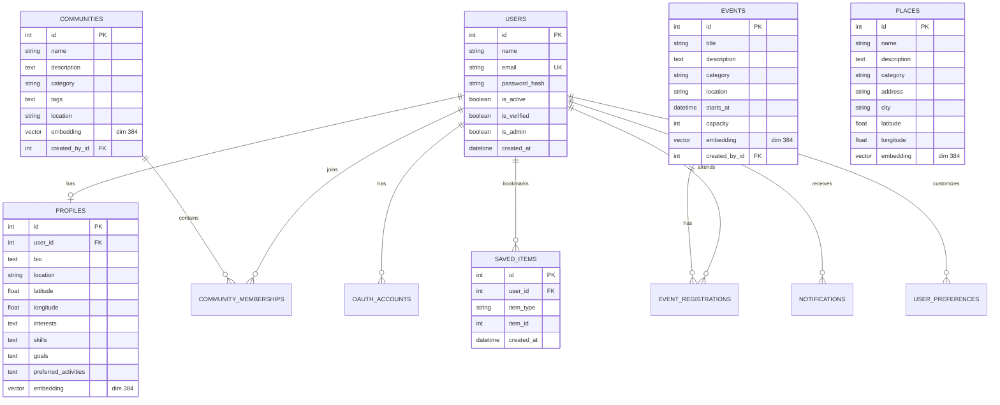

# ALIGN Database & Migrations Guide

## 1. Relational Schema Architecture

The ALIGN PostgreSQL database schema stores all core entities, user profiles, intent vectors, and activity records.



---

## 2. pgvector Setup & Indexing

ALIGN uses `pgvector` for similarity calculations.
Vectors are initialized in SQLAlchemy models using:
```python
from pgvector.sqlalchemy import Vector
embedding: Mapped[list[float] | None] = mapped_column(Vector(384), nullable=True)
```

In SQL, cosine similarity queries run natively:
```sql
SELECT id, name, 1 - (embedding <=> :query_vector) AS similarity
FROM communities
WHERE embedding IS NOT NULL
ORDER BY embedding <=> :query_vector ASC
LIMIT 10;
```

---

## 3. Migration Commands

Alembic manages all schema changes. Migrations run automatically or manually:

### Apply Migrations:
```powershell
cd backend
$env:PYTHONPATH="."
alembic upgrade head
```

### Generate New Revision (after model changes):
```powershell
cd backend
$env:PYTHONPATH="."
alembic revision --autogenerate -m "describe_change"
```

### Rollback Last Migration:
```powershell
cd backend
$env:PYTHONPATH="."
alembic downgrade -1
```

---

## 4. Volume Persistence

The database files are stored in Docker's persistent volume:
`align_postgres_data:/var/lib/postgresql/data`

Data persists across `docker compose down` and container rebuilds. To restart services without losing records:
```powershell
docker compose down
docker compose up -d
```
