# ALIGN Database Schema & Data Dictionary

**Database Engine**: PostgreSQL 16 with `pgvector` extension  
**ORM**: SQLAlchemy 2.0  
**Migration Tool**: Alembic  
**Current Revision**: `007_project_discussions_and_dedup`  

---

## 1. Entity-Relationship Overview

```mermaid
erDiagram
    users ||--o{ refresh_tokens : owns
    users ||--o{ user_activity_logs : logs
    users ||--o{ connections : initiates
    users ||--o{ communities : creates
    users ||--o{ community_members : participates
    users ||--o{ community_discussions : posts
    users ||--o{ events : creates
    users ||--o{ event_registrations : registers
    users ||--o{ places : adds
    users ||--o{ saved_items : saves
    users ||--o{ reels : creates
    users ||--o{ reel_likes : likes
    users ||--o{ projects : creates
    users ||--o{ project_members : participates
    users ||--o{ project_applications : applies
    users ||--o{ project_discussions : discusses
    users ||--o{ messages : sends_or_receives
    users ||--o{ notifications : receives
    users ||--o{ assistant_conversations : owns
    users ||--o{ assistant_memories : stores
    users ||--o{ goal_journeys : plans
    users ||--o{ recommendation_feedback : provides

    communities ||--o{ community_members : has
    communities ||--o{ community_discussions : has
    events ||--o{ event_registrations : has
    projects ||--o{ project_members : has
    projects ||--o{ project_applications : has
    projects ||--o{ project_milestones : has
    projects ||--o{ project_discussions : has
    assistant_conversations ||--o{ assistant_messages : contains
    goal_journeys ||--o{ goal_milestones : contains
```

---

## 2. Table Specifications

### 2.1 Core Identity & Authentication

#### `users`
Central user account table.
| Column | Type | Constraints | Description |
|---|---|---|---|
| `id` | `INTEGER` | `PRIMARY KEY, AUTOINCREMENT` | Unique user identifier |
| `name` | `VARCHAR(100)` | `NOT NULL` | Full display name |
| `email` | `VARCHAR(255)` | `NOT NULL, UNIQUE, INDEX` | Lowercase sanitized email |
| `hashed_password` | `VARCHAR(255)` | `NOT NULL` | Argon2id password hash |
| `bio` | `TEXT` | `NULLABLE` | User self-description |
| `avatar_url` | `VARCHAR(500)` | `NULLABLE` | Profile avatar URL or file path |
| `location` | `VARCHAR(150)` | `NULLABLE` | City / Region location string |
| `latitude` | `FLOAT` | `NULLABLE` | Geographic latitude |
| `longitude` | `FLOAT` | `NULLABLE` | Geographic longitude |
| `skills` | `TEXT` | `NULLABLE` | Comma-separated or listed skills |
| `interests` | `TEXT` | `NULLABLE` | Comma-separated or listed interests |
| `goals` | `TEXT` | `NULLABLE` | User learning and career goals |
| `preferred_activities` | `TEXT` | `NULLABLE` | Preferred meetup/collaboration formats |
| `preferred_community_types` | `TEXT` | `NULLABLE` | Preferred community categories |
| `github_username` | `VARCHAR(100)` | `NULLABLE` | Synced GitHub account username |
| `is_verified` | `BOOLEAN` | `DEFAULT FALSE` | Email verification flag |
| `verification_token` | `VARCHAR(100)` | `NULLABLE` | Email verification secure token |
| `reset_token` | `VARCHAR(100)` | `NULLABLE` | Single-use password reset token |
| `reset_token_expiry` | `TIMESTAMP` | `NULLABLE` | Password reset token expiration |
| `total_xp` | `INTEGER` | `DEFAULT 0` | Verified gamification experience points |
| `level` | `INTEGER` | `DEFAULT 1` | User tier level ($1 + \lfloor \text{XP}/100 \rfloor$) |
| `embedding` | `Vector(384)` | `NULLABLE` | Dense semantic embedding of profile |
| `created_at` | `TIMESTAMP` | `DEFAULT NOW()` | Account creation timestamp |
| `updated_at` | `TIMESTAMP` | `DEFAULT NOW()` | Last profile update timestamp |

#### `refresh_tokens`
Persistent, revocable refresh tokens for secure session continuity.
| Column | Type | Constraints | Description |
|---|---|---|---|
| `id` | `INTEGER` | `PRIMARY KEY, AUTOINCREMENT` | Unique identifier |
| `user_id` | `INTEGER` | `FK(users.id, CASCADE), INDEX` | Associated user |
| `token_hash` | `VARCHAR(255)` | `NOT NULL, UNIQUE, INDEX` | SHA-256 hash of refresh token |
| `expires_at` | `TIMESTAMP` | `NOT NULL` | Token expiration timestamp (30 days) |
| `revoked` | `BOOLEAN` | `DEFAULT FALSE` | Revocation status flag |
| `created_at` | `TIMESTAMP` | `DEFAULT NOW()` | Token issuance timestamp |

#### `connections`
Mutual connection and peer networking graph.
| Column | Type | Constraints | Description |
|---|---|---|---|
| `id` | `INTEGER` | `PRIMARY KEY, AUTOINCREMENT` | Unique identifier |
| `sender_id` | `INTEGER` | `FK(users.id, CASCADE), INDEX` | Requester user ID |
| `receiver_id` | `INTEGER` | `FK(users.id, CASCADE), INDEX` | Recipient user ID |
| `status` | `VARCHAR(20)` | `DEFAULT 'pending'` | `'pending'`, `'accepted'`, `'rejected'` |
| `created_at` | `TIMESTAMP` | `DEFAULT NOW()` | Request timestamp |
| `updated_at` | `TIMESTAMP` | `NULLABLE` | Status update timestamp |

---

### 2.2 Communities & Events

#### `communities`
User-created and managed interest communities.
| Column | Type | Constraints | Description |
|---|---|---|---|
| `id` | `INTEGER` | `PRIMARY KEY, AUTOINCREMENT` | Unique identifier |
| `name` | `VARCHAR(150)` | `NOT NULL, INDEX` | Community name |
| `description` | `TEXT` | `NOT NULL` | Description and charter |
| `category` | `VARCHAR(100)` | `NOT NULL, INDEX` | Primary domain category |
| `purpose` | `VARCHAR(255)` | `NULLABLE` | Core mission statement |
| `image_url` | `VARCHAR(500)` | `NULLABLE` | Cover or badge image |
| `creator_id` | `INTEGER` | `FK(users.id, SET NULL), INDEX` | Founder/Owner user ID |
| `member_count` | `INTEGER` | `DEFAULT 1` | Denormalized count (validated by DB query) |
| `embedding` | `Vector(384)` | `NULLABLE` | Dense semantic embedding |
| `created_at` | `TIMESTAMP` | `DEFAULT NOW()` | Creation timestamp |

#### `community_members`
Association table tracking community membership and roles.
| Column | Type | Constraints | Description |
|---|---|---|---|
| `id` | `INTEGER` | `PRIMARY KEY, AUTOINCREMENT` | Unique identifier |
| `community_id` | `INTEGER` | `FK(communities.id, CASCADE), INDEX` | Community foreign key |
| `user_id` | `INTEGER` | `FK(users.id, CASCADE), INDEX` | Member user foreign key |
| `role` | `VARCHAR(20)` | `DEFAULT 'member'` | `'admin'`, `'moderator'`, `'member'` |
| `joined_at` | `TIMESTAMP` | `DEFAULT NOW()` | Join timestamp |

#### `events`
Physical and virtual events (internal and external Eventbrite).
| Column | Type | Constraints | Description |
|---|---|---|---|
| `id` | `INTEGER` | `PRIMARY KEY, AUTOINCREMENT` | Unique identifier |
| `title` | `VARCHAR(200)` | `NOT NULL, INDEX` | Event title |
| `description` | `TEXT` | `NOT NULL` | Event synopsis |
| `category` | `VARCHAR(100)` | `NOT NULL, INDEX` | Event category |
| `location` | `VARCHAR(255)` | `NOT NULL` | Venue or city address |
| `latitude` | `FLOAT` | `NULLABLE` | Latitude coordinate |
| `longitude` | `FLOAT` | `NULLABLE` | Longitude coordinate |
| `starts_at` | `TIMESTAMP` | `NOT NULL, INDEX` | Event start date & time |
| `ends_at` | `TIMESTAMP` | `NOT NULL` | Event conclusion date & time |
| `max_attendees` | `INTEGER` | `DEFAULT 50` | Maximum seat capacity |
| `registered_count` | `INTEGER` | `DEFAULT 0` | Current verified attendees |
| `creator_id` | `INTEGER` | `FK(users.id, SET NULL), NULLABLE` | Organizer user ID |
| `external_id` | `VARCHAR(100)` | `NULLABLE, UNIQUE, INDEX` | Eventbrite unique identifier |
| `source` | `VARCHAR(50)` | `DEFAULT 'align'` | `'align'` or `'eventbrite'` |
| `url` | `VARCHAR(500)` | `NULLABLE` | External event link |
| `embedding` | `Vector(384)` | `NULLABLE` | Dense semantic embedding |
| `created_at` | `TIMESTAMP` | `DEFAULT NOW()` | Ingestion timestamp |

#### `event_registrations`
User attendance RSVP records.
| Column | Type | Constraints | Description |
|---|---|---|---|
| `id` | `INTEGER` | `PRIMARY KEY, AUTOINCREMENT` | Unique identifier |
| `event_id` | `INTEGER` | `FK(events.id, CASCADE), INDEX` | Event foreign key |
| `user_id` | `INTEGER` | `FK(users.id, CASCADE), INDEX` | Attendee user foreign key |
| `ticket_code` | `VARCHAR(64)` | `NOT NULL, UNIQUE` | Unique cryptographic ticket code |
| `ticket_count` | `INTEGER` | `DEFAULT 1` | Registered seats count |
| `created_at` | `TIMESTAMP` | `DEFAULT NOW()` | Registration timestamp |

---

### 2.3 Places & Saved Items

#### `places`
Validated venues and third-party locations (Google Places / OSM).
| Column | Type | Constraints | Description |
|---|---|---|---|
| `id` | `INTEGER` | `PRIMARY KEY, AUTOINCREMENT` | Unique identifier |
| `name` | `VARCHAR(200)` | `NOT NULL, INDEX` | Venue / Place name |
| `category` | `VARCHAR(100)` | `NOT NULL, INDEX` | Category (Cafe, Library, Coworking) |
| `address` | `VARCHAR(300)` | `NOT NULL` | Street address |
| `city` | `VARCHAR(100)` | `NULLABLE, INDEX` | City |
| `latitude` | `FLOAT` | `NOT NULL` | Latitude coordinate |
| `longitude` | `FLOAT` | `NOT NULL` | Longitude coordinate |
| `image_url` | `VARCHAR(500)` | `NULLABLE` | Curated place photography URL |
| `rating` | `FLOAT` | `DEFAULT 4.5` | Verified average rating |
| `google_place_id` | `VARCHAR(150)` | `NULLABLE, UNIQUE, INDEX` | External Google Places identifier |
| `embedding` | `Vector(384)` | `NULLABLE` | Dense semantic embedding |

#### `saved_items`
Universal user bookmarks across entities.
| Column | Type | Constraints | Description |
|---|---|---|---|
| `id` | `INTEGER` | `PRIMARY KEY, AUTOINCREMENT` | Unique identifier |
| `user_id` | `INTEGER` | `FK(users.id, CASCADE), INDEX` | Saving user foreign key |
| `item_type` | `VARCHAR(50)` | `NOT NULL, INDEX` | `'community'`, `'event'`, `'place'`, `'project'` |
| `item_id` | `INTEGER` | `NOT NULL, INDEX` | Target entity identifier |
| `created_at` | `TIMESTAMP` | `DEFAULT NOW()` | Bookmark timestamp |

---

### 2.4 Collaboration, Projects & Messaging

#### `projects`
Collaborative ventures, hackathon teams, and open-source projects.
| Column | Type | Constraints | Description |
|---|---|---|---|
| `id` | `INTEGER` | `PRIMARY KEY, AUTOINCREMENT` | Unique identifier |
| `title` | `VARCHAR(200)` | `NOT NULL, INDEX` | Project title |
| `description` | `TEXT` | `NOT NULL` | Project charter and scope |
| `creator_id` | `INTEGER` | `FK(users.id, CASCADE), INDEX` | Creator / Lead user ID |
| `category` | `VARCHAR(100)` | `NOT NULL` | Project domain |
| `status` | `VARCHAR(50)` | `DEFAULT 'recruiting'` | `'recruiting'`, `'in_progress'`, `'completed'` |
| `required_skills` | `TEXT` | `NULLABLE` | Comma-separated desired skills |
| `github_repo` | `VARCHAR(255)` | `NULLABLE` | Linked GitHub repository |
| `embedding` | `Vector(384)` | `NULLABLE` | Dense semantic embedding |
| `created_at` | `TIMESTAMP` | `DEFAULT NOW()` | Creation timestamp |

#### `project_applications`
Role applications submitted by prospective collaborators.
| Column | Type | Constraints | Description |
|---|---|---|---|
| `id` | `INTEGER` | `PRIMARY KEY, AUTOINCREMENT` | Unique identifier |
| `project_id` | `INTEGER` | `FK(projects.id, CASCADE), INDEX` | Project foreign key |
| `user_id` | `INTEGER` | `FK(users.id, CASCADE), INDEX` | Applicant foreign key |
| `role_applied` | `VARCHAR(100)` | `NOT NULL` | Proposed role (e.g., Frontend Lead) |
| `pitch` | `TEXT` | `NOT NULL` | Statement of interest & portfolio |
| `status` | `VARCHAR(20)` | `DEFAULT 'pending'` | `'pending'`, `'accepted'`, `'rejected'` |
| `created_at` | `TIMESTAMP` | `DEFAULT NOW()` | Application timestamp |

#### `project_discussions`
Team chat and collaboration threads within a project.
| Column | Type | Constraints | Description |
|---|---|---|---|
| `id` | `INTEGER` | `PRIMARY KEY, AUTOINCREMENT` | Unique identifier |
| `project_id` | `INTEGER` | `FK(projects.id, CASCADE), INDEX` | Project foreign key |
| `user_id` | `INTEGER` | `FK(users.id, CASCADE), INDEX` | Author foreign key |
| `content` | `TEXT` | `NOT NULL` | Message body |
| `created_at` | `TIMESTAMP` | `DEFAULT NOW()` | Timestamp |

#### `messages`
Persistent 1:1 direct messages between users.
| Column | Type | Constraints | Description |
|---|---|---|---|
| `id` | `INTEGER` | `PRIMARY KEY, AUTOINCREMENT` | Unique identifier |
| `sender_id` | `INTEGER` | `FK(users.id, CASCADE), INDEX` | Sender foreign key |
| `receiver_id` | `INTEGER` | `FK(users.id, CASCADE), INDEX` | Recipient foreign key |
| `content` | `TEXT` | `NOT NULL` | Message content |
| `is_read` | `BOOLEAN` | `DEFAULT FALSE, INDEX` | Read receipt flag |
| `created_at` | `TIMESTAMP` | `DEFAULT NOW()` | Message timestamp |

#### `notifications`
Multi-event asynchronous user notifications.
| Column | Type | Constraints | Description |
|---|---|---|---|
| `id` | `INTEGER` | `PRIMARY KEY, AUTOINCREMENT` | Unique identifier |
| `user_id` | `INTEGER` | `FK(users.id, CASCADE), INDEX` | Target user foreign key |
| `type` | `VARCHAR(50)` | `NOT NULL, INDEX` | `'connection'`, `'community'`, `'project'`, `'event'` |
| `title` | `VARCHAR(200)` | `NOT NULL` | Notification headline |
| `content` | `TEXT` | `NOT NULL` | Detail description |
| `link` | `VARCHAR(255)` | `NULLABLE` | Deep-link to resource |
| `is_read` | `BOOLEAN` | `DEFAULT FALSE, INDEX` | Read status |
| `created_at` | `TIMESTAMP` | `DEFAULT NOW()` | Notification timestamp |

---

### 2.5 Assistant V2, Memories & Goals

#### `assistant_conversations`
User-scoped AI Assistant chat sessions.
| Column | Type | Constraints | Description |
|---|---|---|---|
| `id` | `INTEGER` | `PRIMARY KEY, AUTOINCREMENT` | Unique session ID |
| `user_id` | `INTEGER` | `FK(users.id, CASCADE), INDEX` | Owner user ID |
| `title` | `VARCHAR(200)` | `NOT NULL` | Session title |
| `pinned` | `BOOLEAN` | `DEFAULT FALSE` | Pinned priority flag |
| `archived` | `BOOLEAN` | `DEFAULT FALSE` | Archive flag |
| `created_at` | `TIMESTAMP` | `DEFAULT NOW()` | Session start timestamp |
| `updated_at` | `TIMESTAMP` | `DEFAULT NOW()` | Last message timestamp |

#### `assistant_messages`
Ordered message history for assistant turns.
| Column | Type | Constraints | Description |
|---|---|---|---|
| `id` | `INTEGER` | `PRIMARY KEY, AUTOINCREMENT` | Unique message ID |
| `conversation_id` | `INTEGER` | `FK(assistant_conversations.id, CASCADE), INDEX` | Session foreign key |
| `role` | `VARCHAR(20)` | `NOT NULL` | `'user'`, `'assistant'`, `'system'` |
| `content` | `TEXT` | `NOT NULL` | Rendered markdown content |
| `intent` | `VARCHAR(100)` | `NULLABLE` | Classified user intent |
| `action_data` | `TEXT` | `NULLABLE` | JSON serialized action recommendation cards |
| `metadata_json` | `TEXT` | `NULLABLE` | Tool calling logs & citation metadata |
| `created_at` | `TIMESTAMP` | `DEFAULT NOW()` | Message timestamp |

#### `assistant_memories`
Consent-based persistent facts and preferences extracted by the assistant.
| Column | Type | Constraints | Description |
|---|---|---|---|
| `id` | `INTEGER` | `PRIMARY KEY, AUTOINCREMENT` | Memory ID |
| `user_id` | `INTEGER` | `FK(users.id, CASCADE), INDEX` | Owner user ID |
| `memory_type` | `VARCHAR(50)` | `NOT NULL` | `'preference'`, `'fact'`, `'goal'` |
| `content` | `TEXT` | `NOT NULL` | Human-readable stored memory |
| `status` | `VARCHAR(20)` | `DEFAULT 'approved'` | `'approved'`, `'pending'`, `'rejected'` |
| `embedding` | `Vector(384)` | `NULLABLE` | Semantic embedding for RAG |
| `created_at` | `TIMESTAMP` | `DEFAULT NOW()` | Extraction timestamp |

#### `goal_journeys` & `goal_milestones`
Multi-stage guided career and technical development roadmaps.
| Table | Key Columns | Description |
|---|---|---|
| `goal_journeys` | `id, user_id (FK), title, target_category, timeframe, progress_percentage, status` | 7/30/90-day structured roadmap |
| `goal_milestones` | `id, journey_id (FK), step_order, title, description, is_completed, completed_at` | Verifiable milestone checkpoints |

---

### 2.6 Activity & Deduplication

#### `user_activity_logs`
Immutable audit log for verified gamification rewards and platform actions.
| Column | Type | Constraints | Description |
|---|---|---|---|
| `id` | `INTEGER` | `PRIMARY KEY, AUTOINCREMENT` | Unique log entry ID |
| `user_id` | `INTEGER` | `FK(users.id, CASCADE), INDEX` | Subject user foreign key |
| `action` | `VARCHAR(100)` | `NOT NULL, INDEX` | Action key (e.g. `'milestone_completed'`) |
| `xp_earned` | `INTEGER` | `DEFAULT 0` | Points awarded |
| `description` | `VARCHAR(255)` | `NULLABLE` | Human-readable activity description |
| `dedup_key` | `VARCHAR(128)` | `NULLABLE, INDEX` | Idempotency key for anti-duplicate protection |
| `created_at` | `TIMESTAMP` | `DEFAULT NOW()` | Audit timestamp |

---

## 3. Alembic Migration History

| Revision ID | Description | Changes |
|---|---|---|
| `001_initial_schema` | Initial Core Tables | Users, profiles, initial connection schema |
| `002_communities_and_events` | Communities & Events | Community models, members, event registrations |
| `003_places_and_saved` | Places & Bookmarks | Places table with coords, saved_items polymorph |
| `004_hnsw_indexes` | Vector Optimization | Added HNSW cosine indexes on all 9 `Vector(384)` columns |
| `005_reels_table` | Reels Persistence | Database-backed reels and likes persistence |
| `006_assistant_v2_and_goals` | Assistant V2 Architecture | Conversations, messages, memories, journeys, milestones |
| `007_project_discussions_and_dedup` | Collaboration & Gamification | `project_discussions` table and `dedup_key` column on `user_activity_logs` |
