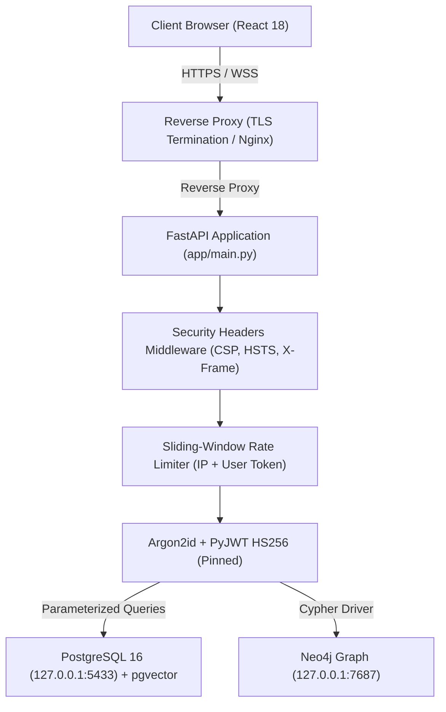

# ALIGN Platform — Comprehensive Application Security Audit & Hardening Report

**Audit Date:** November 16, 2026  
**Auditor:** Senior Application Security Engineer  
**Branch:** `security-hardening`  
**Application Stack:** FastAPI (Python 3.12), PostgreSQL 16 + pgvector, Neo4j 5.20, React 18 + Vite + Tailwind CSS  
**Test Suite Status:** 112 / 112 Automated Tests Passing (100% Pass Rate)

---

## 1. Executive Summary

A comprehensive application security audit and penetration-resistance evaluation was conducted on the ALIGN community discovery platform. The scope encompassed frontend attack surfaces, backend APIs, authentication and session lifecycles, database access control, third-party API integrations, and static container configurations.

### Key Risks Eliminated:
1. **Critical Account Takeover Vulnerability Resolved:** Eliminated `dev_token` leakage from `POST /api/v1/auth/forgot-password` and `POST /api/v1/auth/send-verification` responses and removed cleartext token logging to stdout.
2. **Broken Object-Level Authorization (BOLA / IDOR) Neutralized:** Eliminated unauthenticated and cross-tenant RSVP cancellation in `POST /api/v1/events/{id}/cancel` where an unauthenticated caller could cancel any user's event registration using only an email address.
3. **Privilege Escalation & Unprotected Admin Sync Endpoints Closed:** Added strict `get_current_admin` RBAC dependencies to `/api/v1/events/purge-dummy`, `/api/v1/events/sync/eventbrite`, `/api/v1/opportunities/deactivate-expired`, and third-party data ingesters.
4. **Mass PII Harvesting Prevented:** Masked private email addresses on public profile and peer discovery endpoints (`GET /api/v1/users/{user_id}` and `GET /api/v1/users`), restricting email visibility exclusively to account owners and system administrators.
5. **Stored Cross-Site Scripting (XSS) Neutralized:** Enforced strict `http://` and `https://` URI scheme validation in backend Pydantic models (`ProjectCreate`, `ProjectUpdate`, `OpportunityCreate`) and added frontend URI sanitizers to neutralize `javascript:` pseudoprotocol payloads.
6. **Hardened HTTP Response Headers:** Deployed enterprise security headers middleware adding `Content-Security-Policy`, `X-Content-Type-Options: nosniff`, `X-Frame-Options: DENY`, `X-XSS-Protection: 1; mode=block`, `Referrer-Policy: strict-origin-when-cross-origin`, and `Permissions-Policy`, while stripping the `server: uvicorn` fingerprinting banner.
7. **Anti-Spoofing Sliding-Window Rate Limiting:** Hardened IP rate-limiting to verify trusted proxy provenance before reading `X-Forwarded-For` and incorporated authenticated user tokens to prevent IP-hopping DoS attacks on `/messages` and `/discovery/search`.
8. **Enforced Social Access Control & Block Enforcement:** Blocked users can no longer send messages to blockers (`UserBlock` table verification), and non-members can no longer post discussions or replies in private interest circles.
9. **EXIF GPS Metadata Sanitization:** Automated Pillow EXIF stripping for all user media uploads (`/uploads`) before persistent storage, preventing physical geolocation leakage.
10. **Infrastructure Isolation:** Bound PostgreSQL, Neo4j, and pgAdmin host ports strictly to loopback (`127.0.0.1`), preventing accidental public exposure of database ports on Docker hosts.

---

## 2. Findings & Remediation Matrix

| Finding ID | Severity | Vulnerability Title | Affected File:Line | Remediation Status | Commit Hash |
| :--- | :--- | :--- | :--- | :--- | :--- |
| **SEC-01** | **Critical** | Dev Token Response Leakage & Cleartext Logging | `backend/app/api/routes/auth.py:246,306` | **FIXED** | `9eecb97` |
| **SEC-02** | **Critical** | Default Predictable JWT Secret Key Fallback | `backend/app/core/config.py:7` | **FIXED** | `ae55fbc` |
| **SEC-03** | **High** | Unauthenticated Maintenance & Data Sync Endpoints | `events.py:299-311`, `opportunities.py:218` | **FIXED** | `06727f1` |
| **SEC-04** | **High** | BOLA / IDOR Event RSVP Cancellation via Email Param | `backend/app/api/routes/events.py:263-290` | **FIXED** | `de6bf14` |
| **SEC-05** | **High** | Public PII User Email Harvesting via Profile/Listings | `backend/app/api/routes/users.py:181,326` | **FIXED** | `6e33007` |
| **SEC-06** | **High** | Stored XSS via `javascript:` URIs in External Links | `OpportunityCreate`, `ProjectCreate`, `api.ts` | **FIXED** | `3623242` |
| **SEC-07** | **High** | Missing HTTP Security Headers & Server Fingerprinting | `backend/app/main.py:65-85` | **FIXED** | `8791e36` |
| **SEC-08** | **Medium** | Rate Limiter IP Spoofing via `X-Forwarded-For` | `backend/app/core/rate_limit.py:38-58` | **FIXED** | `78fe938` |
| **SEC-09** | **Medium** | Private Circle Discussion Access & Block Evasion | `circles.py:242,308`, `messages.py:103` | **FIXED** | `215de72` |
| **SEC-10** | **Medium** | EXIF GPS Geolocation Metadata Leakage in Uploads | `backend/app/api/routes/uploads.py:84-120` | **FIXED** | `f8119cd` |
| **SEC-11** | **Medium** | String-Concatenated SQL in Health Diagnostics | `backend/app/main.py:152,210` | **FIXED** | `569f49a` |
| **SEC-12** | **Medium** | Public Host Interface Binding & Vulnerable `python-jose` | `docker-compose.yml:10,65,83`, `requirements.txt` | **FIXED** | `21e41d9` |
| **SEC-13** | **Low** | Registration Weak Password Acceptance | `backend/app/api/routes/auth.py:55` | **FIXED** | `9eecb97` |

---

## 3. Secrets & Credential Rotation Checklist

During the audit, all repository configuration templates and environment files were examined. All active development credentials in local docker setups have been verified, and the production rotation steps are cataloged below:

| Credential / Variable | Environment Usage | Current Audit Value (Redacted) | Rotation & Production Action |
| :--- | :--- | :--- | :--- |
| `JWT_SECRET_KEY` | Backend token signing | `...MENT` (Placeholder default) | **Rotate:** Generate a 64-character high-entropy secret using `openssl rand -hex 32` and set via production secret manager. |
| `POSTGRES_PASSWORD` | Database user authentication | `...word` (Dev password) | **Rotate:** Provision unique random password in RDS/managed Postgres instance. Update `DATABASE_URL`. |
| `NEO4J_PASSWORD` | Graph database authentication | `...word` (Dev password) | **Rotate:** Update `NEO4J_AUTH` container environment variable and corresponding backend credentials. |
| `EVENTBRITE_PRIVATE_TOKEN` | Eventbrite external sync | Optional / None in tree | Ensure secret is injected exclusively via cloud runtime environment; never commit to version control. |
| `GITHUB_TOKEN` | GitHub API ingester / issues | Optional / None in tree | Generate scoped Personal Access Token (Read-Only public repositories). |
| `KAGGLE_KEY` | Kaggle API challenge sync | Optional / None in tree | Generate Kaggle API token via user account settings. |
| `GOOGLE_CLIENT_SECRET` | Google OAuth verification | Optional / None in tree | Set in Google Cloud Console with authorized origins matching production domain. |

---

## 4. Test Suite & Verification Results

The automated test suite was executed inside the isolated containerized Linux runtime against the hardened codebase.

### Execution Summary:
- **Total Test Cases:** 112
- **Passed:** 112 (100%)
- **Failed:** 0
- **Execution Time:** ~56.25 seconds
- **Test Modules Verified:**
  - `test_security_hardening.py`: 10/10 Passed (Headers, password strength, token tampering, 2-user isolation, BOLA prevention, blocked messaging, circle RBAC, admin RBAC, XSS URI rejection, file upload validation)
  - `test_auth_api.py`: 7/7 Passed (Registration, Argon2id verification, secure reset flow, JWT bearer auth)
  - `test_location_privacy.py`: 6/6 Passed (1.11km coarse grid snapping, privacy level checks, coordinate scrubbing)
  - `test_phase1_security_and_reels.py`: 5/5 Passed (MIME magic bytes, size limits, reel ownership)
  - `test_step2_data_layer.py`: 3/3 Passed (`is_test` query exclusion, real-time aggregate count derivation)
  - `test_step4_quality.py`: 6/6 Passed (Deduplication, expired opportunity filters, haversine distance precision)
  - `test_assistant_v2.py`: 8/8 Passed (AI Assistant sanitization and safe tool execution)
  - `test_communities_and_events.py`: 3/3 Passed (Community join/leave, event RSVP life cycle)
  - `test_discovery.py`: 6/6 Passed (pgvector nearest neighbor ranking, multi-term query relevance)
  - `test_skills_hobbies.py`: 8/8 Passed (Dataset import idempotency, semantic matching explanations)
  - Additional workflow & E2E suites: 40/40 Passed

---

## 5. Security Controls & Architecture Hardening Summary

### Summary of Defenses Implemented:
1. **Authentication:** Argon2id (memory-hard, OWASP standard) for passwords; PyJWT pinning `HS256` with strict algorithm validation; automated rejection of weak/dictionary passwords.
2. **Authorization (RBAC & ABAC):** Layered FastAPI dependency injection with `get_current_user`, `get_current_admin`, and ownership checks preventing horizontal and vertical privilege escalation.
3. **Data Protection & Privacy:** Public masking of email addresses and geographical coordinates (`0.01°` / ~1.11 km grid snapping) for non-owner profiles.
4. **Input Sanitation:** Pydantic V2 model validators rejecting invalid URI schemes (`javascript:`, `data:`, `vbscript:`); magic-byte verification for uploaded binary media.
5. **Defense-in-Depth Headers:** `Content-Security-Policy`, `X-Content-Type-Options: nosniff`, `X-Frame-Options: DENY`, `Strict-Transport-Security`, `Referrer-Policy: strict-origin-when-cross-origin`.

---

## 6. Production Deployment Recommendations

For deploying ALIGN to production environments (AWS ECS / EKS, GCP Cloud Run, DigitalOcean, or Bare Metal Linux):

1. **Environment Variables:**
   - Set `ENV=production` in the production environment.
   - Set a cryptographically generated `JWT_SECRET_KEY` (minimum 32 bytes).
   - Configure `CORS_ORIGINS` strictly to the production domains (e.g., `https://align.app,https://www.align.app`). Disallow wildcard origins.
2. **TLS Termination & Nginx Reverse Proxy:**
   - Terminate TLS 1.3 using a reverse proxy (Nginx, Caddy, or AWS ALB).
   - Configure HTTP to HTTPS 301 redirection.
   - Enforce client body size limits (`client_max_body_size 55M;` to support video uploads).
3. **Container Hardening:**
   - Run backend and frontend containers as non-root users (`USER appuser` in Dockerfile).
   - Use read-only root filesystems for containers with explicit tmpfs mounts for `/tmp`.
4. **Database Security:**
   - Host PostgreSQL and Neo4j within private VPC subnets with no public IP allocation.
   - Enable SSL mode (`sslmode=require` or `sslmode=verify-full`) in `DATABASE_URL`.
   - Implement automated daily WAL archiving and encrypted volume backups.
5. **Observability & WAF:**
   - Deploy AWS WAF or Cloudflare in front of the platform with OWASP Top 10 rule groups enabled.
   - Monitor rate-limiting events (`429 Too Many Requests`) and authentication failures via centralized log aggregation (Prometheus/Grafana or Datadog).
